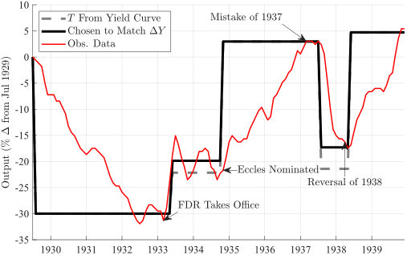

---

##### Download

+ [Paper](eggertsson_schule_fgp.pdf)

---

##### Abstract

The forward guidance puzzle is usually read as a failure of the New Keynesian model: the model predicts that announcements about future interest rates should move output and inflation sharply, yet post-2008 forward guidance looked modest in the data. We argue the puzzle is a property of the policy regime, not of the model. In the canonical experiment the central bank commits to a fixed interim path and does not respond to inflation or output before the promised date---a regime we call *FG-Passive*. Keep the interim feedback---*FG-Active*---and the same model predicts bounded, modest effects. The two episodes that have anchored the debate fall on opposite sides of this line: post-2008 guidance was *FG-Active*, and its effects were modest; four regime shifts during the Great Depression approximated *FG-Passive*, and output and prices moved by the large magnitudes the model implies. Once the regime is correctly classified, the canonical New Keynesian model is consistent with both episodes.

---

##### Figure 8a: Response to Forward Guidance Shocks in the Model and in the Data



---

##### Citation

Eggertsson, Gauti B., and Finn Schüle. 2024. "The Forward Guidance Puzzle is Not a Puzzle." *NBER Working Paper* 33180. https://www.nber.org/system/files/working_papers/w33180/w33180.pdf.

```BibTeX
@article{ES24,
author = {Gauti B. Eggertsson and Finn Schüle},
year = {2024},
title ={Resolving the Forward Guidance Puzzle: Theory and Evidence from the Great Depression and the Great Recession},
journal = {NBER Working Paper},
volume = {33180},
url = {https://www.nber.org/system/files/working_papers/w33180/w33180.pdf}}
```
